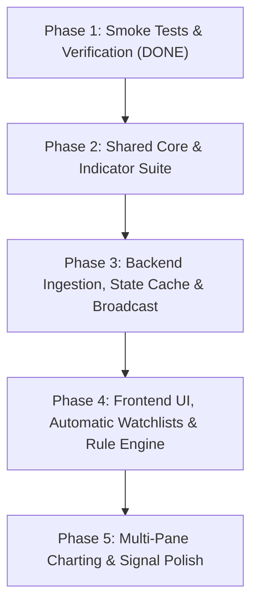

# Real-Time Crypto Scanner — Complete Project Scope & Final Execution Plan

## 1. System Architecture Overview

```
┌────────────────────────────────────────────────────────┐
│               Binance Public Data Feeds                │
│   • WebSocket: !miniTicker@arr (single upstream stream)│
│   • REST: /api/v3/exchangeInfo (daily universe filter) │
│   • REST: /api/v3/klines (seed 200 + hourly sync)      │
└───────────────────────────┬────────────────────────────┘
                            │
                            ▼
┌────────────────────────────────────────────────────────┐
│         Backend: Broadcast Hub & Indicator Engine      │
│  ┌──────────────────────────────────────────────────┐  │
│  │ Ingestion & Resiliency Guard                     │  │
│  │ • Merges partial !miniTicker updates into Map    │  │
│  │ • open > 0 division-by-zero guard on change24h   │  │
│  │ • Make-before-break 20h reconnect with event E   │  │
│  │ • Safe reconnect rollback (never drops old socket│  │
│  │   if new socket fails to connect)                │  │
│  │ • 10s stale-feed watchdog timer                  │  │
│  │ • Universe filter: TRADING, USDT, non-stablecoin │  │
│  └────────────────────────┬─────────────────────────┘  │
│                           │                            │
│  ┌────────────────────────▼─────────────────────────┐  │
│  │ In-Memory Market Cache & 1h Indicator Suite      │  │
│  │ • Async startup seed (200 candles, conc 5)       │  │
│  │ • Hourly sync at XX:00:05 UTC (paced conc 10)    │  │
│  │ • 1. RSI-14: Wilder smoothing + O(1) provisional │  │
│  │ • 2. SMA-20: 20-period moving average of closes  │  │
│  │ • 3. Volume Spike-20: current / avg(prev 20)     │  │
│  │ • Div-by-zero guards & unavailable=null/undefined│  │
│  └────────────────────────┬─────────────────────────┘  │
│                           │                            │
│  ┌────────────────────────▼─────────────────────────┐  │
│  │ Downstream Broadcast & Fallback Server           │  │
│  │ • Single JSON.stringify per tick for all clients │  │
│  │ • perMessageDeflate disabled (zero CPU churn)    │  │
│  │ • Backpressure: skip if buffer > 256KB           │  │
│  │ • Transparent /api/klines proxy fallback for     │  │
│  │   geo/CORS-restricted client browsers            │  │
│  └────────────────────────┬─────────────────────────┘  │
└───────────────────────────┼────────────────────────────┘
                            │ WebSocket Broadcast (1 msg/sec, 30-45KB)
                            ▼
┌────────────────────────────────────────────────────────┐
│            Frontend Client Application (SPA)           │
│  ┌──────────────────────────────────────────────────┐  │
│  │ Automatic Watchlists (Distinct Feature Views)    │  │
│  │ • Top Gainers (ranked by 24h % change desc)      │  │
│  │ • Top Losers (ranked by 24h % change asc)        │  │
│  │ • Highest Volume (ranked by quote volume desc)   │  │
│  │ • Derived dynamically in memory from each tick   │  │
│  ├──────────────────────────────────────────────────┤  │
│  │ Client-Side Scanner & Transition Tracker         │  │
│  │ • Silent baseline on load/reconnect/rule-edit    │  │
│  │ • Multi-indicator conditions (RSI, SMA, Volume)  │  │
│  │ • Rules in localStorage (versioned + Zod)        │  │
│  │ • Hysteresis: 2 consecutive batches before exit  │  │
│  │ • Re-entry cooldown (10s)                        │  │
│  │ • Missing indicator rules safely return false    │  │
│  ├──────────────────────────────────────────────────┤  │
│  │ High-Performance Virtualized Full Universe Table │  │
│  │ • TanStack Virtual 60fps DOM recycling (~350)    │  │
│  │ • Per-row Zustand subscriptions                  │  │
│  │ • CSS-class flash animations on price ticks      │  │
│  │ • Isolated form states (typing immune to 1Hz tick│  │
│  ├──────────────────────────────────────────────────┤  │
│  │ Personal User Watchlists                         │  │
│  │ • Named user-created watchlists (star toggle ★)  │  │
│  │ • Persisted in localStorage (versioned + Zod)    │  │
│  └────────────────────────┬─────────────────────────┘  │
│                           │ (On user click)
                            ▼
┌────────────────────────────────────────────────────────┐
│     Detail Chart Modal (Direct Browser to Binance)     │
│   • Direct REST /api/v3/klines (seed 200 candles)      │
│   • Auto-fallback to backend proxy if CORS/blocked     │
│   • Direct WS <symbol>@kline_<interval> live updates   │
│   • Shared Wilder's RSI function with 1h pane label    │
│   • Lightweight Charts v5 Multi-Pane Layout            │
│     [Candlestick Series | Volume Pane | RSI Pane]      │
└────────────────────────────────────────────────────────┘
```

---

## 2. Core Dashboard Features & Separation of Concerns

The dashboard separates market data views into four explicit, purposeful components:

```
┌────────────────────────────────────────────────────────────────────────┐
│                               HEADER                                   │
│  Connection Status [Connected / 1 Hz]  •  Active Universe: 342 Coins   │
├────────────────────────────────────────────────────────────────────────┤
│                  AUTOMATIC WATCHLISTS (Feature 1)                      │
│ ┌──────────────────────┐ ┌──────────────────────┐ ┌──────────────────┐ │
│ │  🔥 TOP GAINERS      │ │  ❄️ TOP LOSERS       │ │ 📊 HIGH VOLUME   │ │
│ │  1. COIN1  +24.5%    │ │  1. COIN4  -18.2%    │ │ 1. BTC  $2.4B    │ │
│ │  2. COIN2  +19.1%    │ │  2. COIN5  -12.7%    │ │ 2. ETH  $1.1B    │ │
│ │  ... (Top 5-10 cards)│ │  ... (Top 5-10 cards)│ │ ... (Top 5-10)   │ │
│ └──────────────────────┘ └──────────────────────┘ └──────────────────┘ │
├────────────────────────────────────────────────────────────────────────┤
│              CUSTOM SCANNER & MATCH FEED (Feature 2)                   │
│  [+ New Scanner Rule]  Active Rules: [Breakout Momentum] [RSI Bounce]  │
│  Live Matching Coins: [BTC] [SOL] [NEAR] (with condition explanations) │
├────────────────────────────────────────────────────────────────────────┤
│           VIEW TABS: [All Coins (342)] | [⭐ My Watchlists]            │
│  Full Search & Filter  •  TanStack Virtual 60fps Grid Table            │
└────────────────────────────────────────────────────────────────────────┘
```

### A. Automatic Watchlists (Market Condition Derived)
- **Top Gainers**: Top 10 coins ranked descending by `c24` (24-hour percentage change).
- **Top Losers**: Top 10 coins ranked ascending by `c24` (lowest/deepest negative first).
- **Highest Volume**: Top 10 coins ranked descending by `v24` (quote asset volume in USDT).
- **Update Behavior**: Derived dynamically in-memory on every 1Hz WebSocket message via a dedicated Zustand selector (`useMarketStore.getState().getAutoWatchlists()`). Zero database queries or complex subsystems required.
- **Visual Presentation**: Rendered as interactive spotlight cards / mini-lists above the main table with real-time price updates and 1-click modal triggers.

### B. Personal User Watchlists (User Curated)
- Explicit user-managed lists (e.g. "Favorites", "Layer 1s", "High Beta").
- Users can star/unstar any coin from the main table, automatic watchlist cards, or detail modal.
- Switchable tab view in the table section to display only starred/selected coins.
- Persisted in browser `localStorage` with versioned schema validation (`scanner:watchlists:v1`).

### C. Custom Scanner Engine (Multi-Indicator Rule Evaluated)
- User-defined multi-condition rules with `AND` / `OR` logic.
- Evaluates against:
  - Price metrics: `p`, `c24`, `v24`
  - Technical indicators: `rsi14_1h` (momentum), `sma20_1h` (trend), `volumeRatio20_1h` (volume spike)
- Evaluated in-browser against incoming snapshot.
- Transition tracker handles `entered` and `exited` states with hysteresis (2 consecutive failure batches) and 10s cooldown.

### D. Full Market Universe Table
- Virtualized scrolling via `@tanstack/react-virtual` for all ~350 USDT pairs.
- Search by symbol, sortable columns, and click-to-inspect chart modal.

---

## 3. Data Specification & Shared Types (`shared/src/types.ts`)

```typescript
/**
 * Normalized market data object shared between backend and frontend.
 * Represents a single coin's live market statistics and computed 1h indicators.
 */
export interface MarketCoinDTO {
  /** Trading pair symbol, e.g. "BTCUSDT" */
  s: string;

  /** Current market price (last trade price from miniTicker 'c') */
  p: number;

  /** 24-hour percentage price change = ((c - o) / o) * 100 (rounded to 2 decimals) */
  c24: number;

  /** 24-hour rolling high price (from miniTicker 'h') */
  h24: number;

  /** 24-hour rolling low price (from miniTicker 'l') */
  l24: number;

  /**
   * 24-hour rolling quote asset volume in USDT (turnover from miniTicker 'q').
   * Distinct from individual 1-hour candle volume.
   */
  v24: number;

  /**
   * Wilder's 14-period RSI computed on 1-hour candle closes (with live O(1) provisional tick).
   * Range: 0 to 100. Optional: undefined if < 15 closed candles available.
   * Note: Unavailable indicators must NEVER be represented as 0.
   */
  rsi14_1h?: number;

  /**
   * 20-period Simple Moving Average of 1-hour candle closes.
   * Optional: undefined if < 20 closed candles available.
   */
  sma20_1h?: number;

  /**
   * Volume Spike Ratio on 1-hour timeframe:
   * (current 1h candle volume) / (average volume of preceding 20 completed 1h candles).
   * Note: Current hourly candle volume is provisional until the hour closes.
   * Both the current candle and the 20 historical candles must use the exact same volume unit.
   * Optional: undefined if < 20 completed historical candles or baseline is zero.
   */
  volumeRatio20_1h?: number;
}

/**
 * Message payload broadcasted from backend to all connected frontend clients at 1 Hz.
 */
export interface MarketBroadcastPayload {
  /** Message discriminator */
  type: 'market_snapshot';

  /** Server timestamp in Unix milliseconds when snapshot was assembled */
  timestamp: number;

  /** Complete snapshot array of tracked market coins */
  coins: MarketCoinDTO[];
}

/**
 * Automatic watchlists dynamically ranked by market conditions.
 * Contains symbol arrays for the top-ranked coins.
 */
export interface AutoWatchlists {
  topGainers: string[];
  topLosers: string[];
  highestVolume: string[];
}

/** Valid numeric fields available for rule evaluation */
export type RuleField = 'p' | 'c24' | 'v24' | 'rsi14_1h' | 'sma20_1h' | 'volumeRatio20_1h';

/** Supported comparison operators */
export type ComparisonOperator = '>' | '<' | '>=' | '<=' | '==' | '!=';

/** Structure of a single condition within a scanner rule */
export interface RuleCondition {
  field: RuleField;
  operator: ComparisonOperator;
  value: number;
}

/** User-defined or preset scanner rule */
export interface ScannerRule {
  id: string;
  name: string;
  enabled: boolean;
  logic: 'AND' | 'OR';
  conditions: RuleCondition[];
}

/** User-created custom watchlist */
export interface UserWatchlist {
  id: string;
  name: string;
  symbols: string[];
}
```

### Volume Semantics & Disambiguation
It is critical to distinguish between the three distinct volume metrics:
1. `v24`: 24-hour rolling quote volume in USDT (e.g. $1.2B USDT turnover across all trades in the last 24h from miniTicker `q`).
2. **Hourly Candle Volume**: Quote volume accumulated in a single 1-hour candle window (Binance kline index `[7]`).
3. `volumeRatio20_1h`: Dimensionless ratio comparing an hourly candle volume to the average quote volume of the preceding 20 completed hourly candles.
   - **Option A Implementation (Hourly Refresh Architecture)**:
     - Binance's `!miniTicker@arr` stream only streams 24h rolling volume (`q`), not live forming 1h candle volumes.
     - Therefore, `volumeRatio20_1h` is seeded at startup from the initial REST klines and refreshed when a new 1h candle closes via the hourly sync.
     - **Distinction**: It is NOT a tick-by-tick live metric during the hour. It represents the ratio evaluated at hourly candle boundaries.
     - Both the candle volume and the 20 historical candles strictly use quote volume in USDT (kline index `[7]`).
     - If the 20-candle baseline average is zero or history < 20, the ratio returns `undefined` (omitted from DTO), preventing division-by-zero and false alert signals.

---

## 4. Technical Indicator Mathematical Specifications

### A. Wilder's RSI-14 (`shared/src/rsi.ts`)
- **Input**: Chronological array of closing prices ($C_0, C_1, \dots, C_n$).
- **Requirements**:
  - Return `null` if `closes.length < period + 1` (requires at least 15 closes for period 14).
  - Price changes: $\Delta_i = C_i - C_{i-1}$, $\text{gain}_i = \max(\Delta_i, 0)$, $\text{loss}_i = \max(-\Delta_i, 0)$.
  - **Initial Seed (first 14 changes)**: Simple moving average:
    $$\text{AvgGain}_{14} = \frac{1}{14} \sum_{i=1}^{14} \text{gain}_i, \quad \text{AvgLoss}_{14} = \frac{1}{14} \sum_{i=1}^{14} \text{loss}_i$$
  - **Recursive Wilder Smoothing (changes 15 to $n$)**:
    $$\text{AvgGain}_i = \frac{\text{AvgGain}_{i-1} \times 13 + \text{gain}_i}{14}, \quad \text{AvgLoss}_i = \frac{\text{AvgLoss}_{i-1} \times 13 + \text{loss}_i}{14}$$
  - **Stable RSI Calculation**:
    $$\text{RSI} = 100 \times \frac{\text{AvgGain}}{\text{AvgGain} + \text{AvgLoss}}$$
  - **Edge-Case & Division-by-Zero Handling**:
    - $\text{AvgLoss} = 0 \text{ and } \text{AvgGain} > 0 \implies \text{RSI} = 100$.
    - $\text{AvgGain} = 0 \text{ and } \text{AvgLoss} > 0 \implies \text{RSI} = 0$.
    - $\text{AvgGain} = 0 \text{ and } \text{AvgLoss} = 0 \implies \text{RSI} = 50$ (flat-market convention).
    - Result is guaranteed finite and within $[0, 100]$.
- **What the Provisional $O(1)$ Live RSI Represents**:
  - The live RSI represents an intraday estimate calculated using the **previous completed candle's close** and the **committed Wilder smoothed averages** as its baseline.
  - **Repeated live price ticks must NOT update or mutate those committed averages.** Each incoming tick calculates a provisional value against the same fixed baseline.
  - A new baseline is committed **only when a new hourly candle closes**.
  - Performs constant $O(1)$ time and space per tick.

### B. Simple Moving Average SMA-20 (`shared/src/sma.ts`)
- **Input**: Chronological array of closing prices ($C_0, C_1, \dots, C_n$).
- **Requirements**:
  - Return `null` if `closes.length < period` (requires at least 20 closes).
  - Arithmetic mean of the most recent `period` closes:
    $$\text{SMA}_{20} = \frac{1}{20} \sum_{i=n-19}^{n} C_i$$
  - Pure function, array immutability preserved, returns finite number.

### C. Volume Spike-20 Ratio (`shared/src/volume.ts`)
- **Input**: `currentVolume` (number), `previousVolumes` (readonly array of completed candle volumes).
- **Requirements**:
  - Return `null` if `previousVolumes.length < 20`.
  - Both `currentVolume` and all items in `previousVolumes` must use the **identical volume unit** (e.g. quote volume in USDT).
  - Current volume is provisional until the hour closes.
  - Takes the latest 20 completed volumes:
    $$\text{AvgVol}_{20} = \frac{1}{20} \sum_{i=m-19}^{m} V_i$$
  - If $\text{AvgVol}_{20} = 0$, return `null` (undefined baseline, avoid division by zero).
  - Ratio calculation:
    $$\text{volumeRatio20} = \frac{\text{currentVolume}}{\text{AvgVol}_{20}}$$
  - Validates that volumes are non-negative and finite.

---

## 5. Scope Management & 3–4 Day Deadline Prioritization

To ensure a successful demonstration within the 3–4 day timeframe, features are strictly prioritized. The core scanner must work end-to-end first before investing time in optimization layers.

| Priority Tier | Features | Rationale |
| :--- | :--- | :--- |
| **Tier 1: Core Must-Haves (Demonstration Critical)** | • Live Binance Ingestion (`!miniTicker@arr`) & In-Memory Map Cache<br>• 1Hz Downstream WebSocket Broadcast Hub<br>• Automatic Watchlists (Gainers, Losers, High Volume)<br>• Personal User Watchlists (LocalStorage)<br>• Custom Scanner Rule Builder (AND/OR, numeric operators)<br>• Live Scanner Evaluation with Enter/Exit Transitions | These deliver the complete core experience required by the founder. If only Tier 1 is built, the demo is 100% functional. |
| **Tier 2: Robustness & Depth (Layer on as time permits)** | • DOM Virtualization (`@tanstack/react-virtual`)<br>• Make-Before-Break WebSocket reconnect & watchdog<br>• Backpressure frame-skipping on saturated clients<br>• Fallback `/api/klines` proxy for geo-blocked environments<br>• Multi-Pane TradingView Lightweight Chart Modal | Excellent engineering practices that harden the application, added incrementally without blocking Tier 1 milestones. |

---

## 6. Implementation Traps & Rigorous Safeguards

### 1. Ingestion: Partial Update Merging & Div-Zero Protection
- `!miniTicker@arr` sends **only symbols that changed** in the last second, not the full universe.
- The backend cache maintains an in-memory `Map<string, MarketCoin>()`.
- **Division Guard**: If `open === 0`, `change24h = 0`:
  ```typescript
  const open = parseFloat(item.o);
  const close = parseFloat(item.c);
  const change24h = open > 0 ? ((close - open) / open) * 100 : 0;
  ```
- The broadcast iterates `cache.values()` to send the complete universe snapshot.

### 2. Indicator Seeding & Calculation Timing Safeguards
- **Missing Indicator Safety**: Conditions checking indicators on unseeded coins evaluate to `false` (never throw errors or produce NaN).
- **Prioritized Startup Seeding (Rate-Limit Friendly)**:
  - Do NOT seed 200 candles for every coin immediately.
  - Fetch exchange metadata first, then rank eligible pairs by 24h quote volume (`v24`).
  - Seed the top 50–100 pairs first with 21–50 completed 1h candles (minimum 21 required for RSI-14, SMA-20, and 20-candle volume baseline).
  - Expand to the remaining universe gradually only if rate-limit budget allows.
- **Proper Calculation Timing**:
  - Live ticks must NOT recompute indicators from scratch.
  - RSI uses $O(1)$ provisional calculation without mutating committed averages.
  - SMA-20 updates when the hourly candle closes (can be updated provisionally with live price).
  - Volume ratio updates using the current candle's accumulating volume against the completed 20-candle baseline.
- **Paced Hourly REST Sync (at `XX:00:05 UTC`)**:
  - Drops open candles (`closeTime < now`).
  - Commits unseen closed candles in order (`openTime > lastCommittedOpenTime`).
  - Paced queue with concurrency = 10.

### 3. Client Alert Storm & Hysteresis Guards
- **Silent Baseline**: On initial page load, after a WebSocket reconnect, or whenever a rule is edited/toggled, the scanner runs an immediate **silent evaluation** (populates match state without firing alerts).
- **Exit Hysteresis**: A coin must fail to match for **2 consecutive 1-second batches** before triggering an exit transition.
- **Re-entry Cooldown**: Suppresses re-triggering notifications for the same symbol within 10 seconds of a previous exit.

### 4. Make-Before-Break 20-Hour Reconnect with Rollback
- At hour 20, open `newSocket`.
- Only process packets if `item.E >= coin.lastEventTime`.
- If `newSocket` fails to connect, **do NOT terminate `oldSocket`**; retry after 30 seconds.
- Terminate `oldSocket` only after `newSocket` receives its first valid batch.

### 5. Universe Filtering & Stablecoin Exclusion
- Source: `/api/v3/exchangeInfo` on startup, refreshed daily.
- Inclusion: `status === 'TRADING'`, `quoteAsset === 'USDT'`.
- Exclusion blacklist: `['USDC', 'FDUSD', 'TUSD', 'BUSD', 'DAI', 'USDP', 'EUR', 'AEUR', 'USDS', 'USD1', 'PYUSD', 'USDE', 'XUSD', 'FRAX']`.
- Heuristic backstop: Exclude pairs where `0.98 <= price <= 1.02` and 24h spread $< 1.5\%$.

### 6. Storage Validation, Network Performance & UI Stability
- Versioned keys: `scanner:rules:v1`, `scanner:watchlists:v1` validated with Zod.
- Single `JSON.stringify` per tick, `perMessageDeflate: false`.
- Backpressure: skip frames if client buffer > 256KB.
- Form focus isolation: UI form inputs do not re-render on 1Hz ticker stream.
- Chart direct fetch with transparent `/api/klines` proxy fallback.

---

## 7. Definitive Risk-First Build Order



### Phase 1: Smoke Tests & Verification (COMPLETED ✅)
- [x] Node.js connectivity: REST klines (`data-api.binance.vision`, `api.binance.com`) and `!miniTicker@arr` WebSocket verified.
- [x] Browser CORS test: verified direct browser-to-Binance reachability.
- [x] Verified partial-update behavior: batch sizes vary (23, 71, 86 USDT pairs), proving the necessity of in-memory Map merging.

### Phase 2: Shared Core (`shared/`) — [COMPLETED ✅]
- [x] Initialize `shared/` with strict TypeScript configuration (`tsconfig.json`, `package.json`).
- [x] Configure Vitest as the test runner for fast, pure TypeScript unit testing.
- [x] Implement `shared/src/types.ts`:
  - `MarketCoinDTO` with `s`, `p`, `c24`, `h24`, `l24`, `v24`, `rsi14_1h?`, `sma20_1h?`, `volumeRatio20_1h?`.
  - `MarketBroadcastPayload` with message discriminator `type: "market_snapshot"`.
  - `AutoWatchlists` with `topGainers`, `topLosers`, `highestVolume` symbol arrays.
  - `RuleCondition` with `RuleField`, `ComparisonOperator`, `value`.
  - `ScannerRule` with `logic: "AND" | "OR"`.
- [x] Implement `shared/src/rsi.ts`:
  - `calculateRSI(closes, period = 14)`.
  - Initial 14-period SMA seed + recursive Wilder smoothing.
  - Division-by-zero & flat-market handling (50 for flat, 100 for zero loss, 0 for zero gain).
  - Provisional $O(1)$ calculation with committed baseline (does not mutate committed averages).
- [x] Implement `shared/src/sma.ts`:
  - `calculateSMA(closes, period = 20)`.
  - Arithmetic mean of latest 20 closes, immutable array operations.
- [x] Implement `shared/src/volume.ts`:
  - `calculateVolumeRatio(currentVolume, previousVolumes)`.
  - Consistent volume unit across all 21 candles.
  - Zero average baseline guard (returns `null`).
- [x] Implement `shared/src/index.ts`: Public exports for types and functions.
- [x] Unit test suites in `shared/tests/`:
  - **Testing Standard**: 100% test coverage is NOT required for the demo. Instead, require **all tests to pass** and thoroughly cover important edge cases (boundary lengths, zero denominators, flat markets, invalid inputs, immutability).
  - `rsi.test.ts`: Insufficient data, boundary lengths, monotonic series, flat series, Wilder smoothing convergence, provisional $O(1)$ immutability and equivalence.
  - **RSI Reference Verification Detail**: Compare values calculated from the same closing prices, candle interval, RSI period, and initialization convention. Note that TradingView values may differ slightly because of initialization history length and data source differences. If an actual TradingView reference series cannot be verified, document that limitation clearly instead of claiming the comparison was completed.
  - `sma.test.ts`: 20-period moving average, insufficient data, immutability, updated price series.
  - `volume.test.ts`: 20-candle ratio, zero volume, zero baseline, insufficient history, invalid inputs.
  - `types.test.ts`: Type structure and sample object compliance.
- [x] Verify `npm run typecheck` and `npm test` pass (86/86 tests green, 0 TS errors).

### Phase 3: Backend Core (`backend/`)
- [ ] **Universe Manager & Metadata**:
  - Fetch `/api/v3/exchangeInfo` first, filter `status === 'TRADING'` and `quoteAsset === 'USDT'`.
  - Apply stablecoin exclusion blacklist.
- [ ] **Simplest Working Ingestion Pipeline (Build & Verify First)**:
  - Connect to Binance `!miniTicker@arr` WebSocket.
  - In-memory `Map<string, MarketCoin>` with partial-update merging and `open > 0` div-zero guard.
  - Broadcast 1Hz universe snapshot to backend WebSocket clients (`ws://localhost:4000`).
  - Verify prices update end-to-end before adding advanced resilience.
- [ ] **Prioritized Indicator Seeding (Rate-Limit Friendly)**:
  - Do NOT seed all ~350 coins immediately.
  - Rank eligible pairs by initial 24h quote volume (`v24`).
  - Seed the top 50–100 pairs first (fetching 21–50 completed 1h candles: at least 21 candles required for RSI-14, SMA-20, and 20-candle volume baseline).
  - Expand to lower-volume pairs incrementally only if rate-limit budget permits.
- [ ] **Proper Indicator Timing & Computation**:
  - **Live Ticks**: Do NOT recompute indicators from scratch on every tick.
    - RSI: Compute provisional value from live price against committed baseline ($O(1)$).
    - SMA-20: Update baseline when hourly candle closes (optionally include live price provisionally).
    - Volume ratio: Update using accumulating current candle volume against the 20 completed candle baseline.
  - **Hourly Candle Close**: At `XX:00:05 UTC`, sync newly closed 1h candles and commit new baselines.
- [ ] **Robustness Hardening (Add after basic pipeline works)**:
  - Binance WS 10s watchdog / heartbeat.
  - Make-before-break proactive reconnection.
  - Backpressure protection (skip frames if client socket buffer is saturated).
  - Fallback `/api/klines` proxy endpoint for client chart modal.

### Phase 4: Frontend UI, Automatic Watchlists & Rule Engine (`frontend/`)
- [ ] Setup Vite + React + TypeScript + Tailwind CSS.
- [ ] Zustand store with versioned `localStorage` persistence and Zod schema validation.
- [ ] Automatic Watchlists Component: Top Gainers, Top Losers, Highest Volume.
- [ ] Client-side Scanner Engine:
  - Evaluates rules in-memory on every 1s broadcast across price, RSI, SMA, and Volume Ratio.
  - Silent baseline initialization (no alert storms).
  - Hysteresis: 2-batch exit confirmation, 10s re-entry cooldown.
- [ ] Rule Builder UI: AND / OR logic, numeric comparisons, preset rules, isolated form state.
- [ ] Personal User Watchlists: Star/unstar toggle (`★`), tabbed view.
- [ ] Virtualized Market Table: `@tanstack/react-virtual` 60fps table.

### Phase 5: Charting & Detail Modal
- [ ] TradingView Lightweight Charts v5 modal:
  - Pane 0: Candlestick series.
  - Pane 1: Volume histogram.
  - Pane 2: RSI 14 (1h) line series with 30/70 reference lines.
- [ ] Direct browser-to-Binance data fetching with backend proxy fallback.
- [ ] Condition breakdown pills in modal/drawer explaining exactly which rules passed.
- [ ] End-to-end verification, loading/reconnect indicators, and demo run-through.
